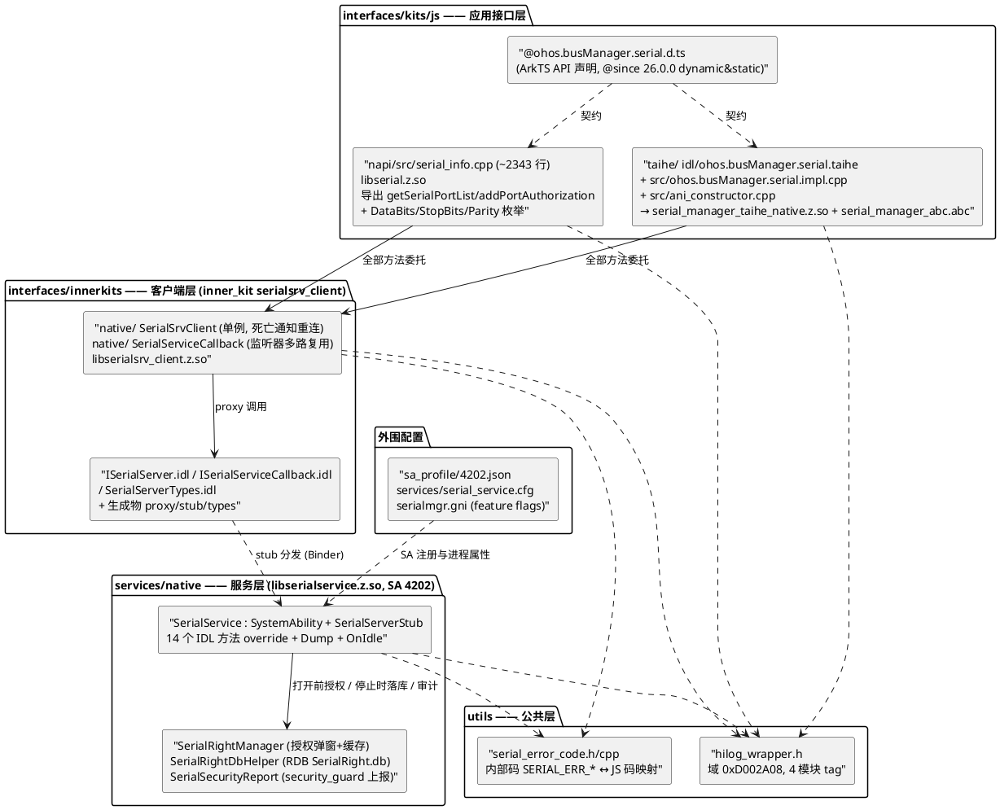

# 架构设计及约束

## 架构设计

### 设计原则

| 原则 | 描述 | 理由 |
|---|---|---|
| 接口先行、IDL 为源 | 对外 IPC 契约集中在 `interfaces/innerkits/*.idl`；stub/proxy/types 全部由 IDL 工具链生成到 `out/<product>/gen/base/busmanager/serial_manager/interfaces/innerkits/` | IPC 是跨进程 wire 协议，生成物不可手改；改 IDL 后用 `--fast-rebuild` 重新生成并同步 override 签名（AGENTS.md「IDL 代码生成」） |
| 分层单向依赖 | 应用接口层（kits/js）→ 客户端层（innerkits）→ 服务层（services），utils 为公共层；服务不反向依赖 kits/客户端实现 | 与 OpenHarmony 部件规范一致；`interfaces/` 不依赖 `services/`，inner_kit 仅暴露 `serial_srv_client.h`（`bundle.json` inner_kits） |
| 双绑定等价 | NAPI 与 Taihe 两条 JS 绑定共用同一 `.d.ts` 契约，且都只委托 `SerialSrvClient`，不各自实现业务逻辑 | 同一模块名 `@ohos.busManager.serial` 动态（NAPI）与静态（Taihe）双形态交付（`.d.ts` `@since 26.0.0 dynamic&static`） |
| 权限缓存优先 | 授权判定只读内存缓存（`SerialRightManager::HasRight`），RDB 仅在 SA OnStart 加载、OnStop 落库 | 打开操作是高频路径，避免每次 IPC 都访问数据库；代价见 Technology「应用授权机制」 |
| 服务状态单锁保护 | `SerialService::serviceMutex_` 保护 `deviceContexts_`、`productIdVendorIdToPortName_`、卸载定时器等全部可变服务状态 | 服务端并发来源包括 IPC 线程池、HDI 回调线程、参数监听回调、init 定时器线程，单锁串行化是最简单的正确性方案 |
| 生命周期自动化 | 按需加载（run-on-create=false + start-on-demand）、空闲 30s 延时自卸载、客户端死亡与设备离线自动清理 | SA 常驻会浪费内存；异常退出由 auto-restart 兜底 |
| 测试变体与正式实现隔离 | 正式目标不含任何测试宏；`test/develop/` 的 5 个服务变体是独立源文件（同 SA 框架代码 + 各自的模拟逻辑），`install_enable = false` | AGENTS.md「设计原则」：不在正式目标中通过宏或 GN 参数控制测试行为 |
| 硬编码安全契约 | 日志域 `0xD002A08`、审计事件 ID `0x030000100`/`0x030000101`、EDM 参数名、SELinux 标签固定不变 | DFX 采集与安全审计按固定取值对接（AGENTS.md「禁止与请示」） |

### 逻辑架构



各层职责与关键调用链（自上而下）：

1. **应用接口层** `interfaces/kits/js/`
   - `.d.ts`：唯一对外 API 契约，含每个方法的 `@throws` 错误码声明。
   - NAPI（`serial_info.cpp`）：模块名 `busManager.serial`，`RegisterSerialModule` 构造函数注册。顶层导出 `getSerialPortList`/`addPortAuthorization` 与三个枚举；`SerialPort` 为 JS 对象（`portName` 属性 + `portInfo` 子对象 + 14 个方法），通过 `napi_wrap` 绑定 `SerialPortNative*`。所有变更操作走 `napi_create_async_work`（Worker 线程执行 `SerialSrvClient` 调用，JS 线程 Complete 解析/拒绝 Promise）。端口对象缓存放 `g_activePorts`/`g_invalidatedPorts`（见 Technology「端口对象缓存与失效恢复」）。
   - Taihe（`taihe/`）：`ohos.busManager.serial.taihe` IDL 经 `run_taihe` 生成 `.ani.cpp`/`.abi.c`；`ani_constructor.cpp` 的 `ANI_Constructor` 注册模块；`ohos.busManager.serial.impl.cpp` 中 `SerialPortHolder`/`SerialPortInfoHolder` 持有端口状态并全部委托 `SerialSrvClient`；`generate_static_abc` 生成 boot ABC 安装到 `/system/framework/serial_manager_abc.abc`。
2. **客户端层** `interfaces/innerkits/`
   - IDL 生成物把请求序列化后经 Binder 发往 SA；`ISerialServiceCallback` 的 `serial_service_callback_stub` 驻留客户端接收服务端 oneway 回调。
   - `SerialSrvClient`（`serial_srv_client.cpp`）：static 局部变量单例；`GetProxy()` 空则 `LoadSystemAbility(4202, 4s)`；`SerialSrvDeathRecipient` 监听服务死亡 → `ResetProxy` → 下次调用自动重连；所有 IPC 返回值经 `SerialInternalToJsCode()` 转成 JS 错误码再返回调用方。
   - `SerialServiceCallback`（`serial_service_callback.cpp`）：`map<portName, map<handle, callback>>` 监听器多路复用；首个注册触发 `StartRead`、最后一个移除触发 `StopRead`。
3. **服务层** `services/native/`
   - `SerialService`（`serial_service.cpp`，1843 行）：`OnStart` 依次完成 EDM 参数监听 → `InitHdiProxy` → `LoadPcieSerialConfig` → `SerialRightManager::Init` → IPC full 监控 → 卸载定时器初始化 → `Publish`。14 个 IDL 方法统一模式：审计 → EDM 检查 → 参数校验 → `serviceMutex_` 加锁 → `FindDeviceContext` → `CheckPortAccessPermission`（tokenId 归属校验）→ HDI 调用 → `SerialHdiToInternalCode` 错误映射。
   - `SerialRightManager` / `SerialRightDbHelper` / `SerialSecurityReport`：授权、持久化与审计子模块（见 Entity/Technology）。
4. **公共层** `utils/native/`：错误码双体系与日志宏，被以上三层的客户端侧共同依赖（服务侧由 `serial_server_stub` 与 `serialservice` 目标引用）。

**部署形态**（`bundle.json` build.group_type）：
- `fwk_group`：`serialsrv_client`（inner_kit，头文件 `serial_srv_client.h`）、`serial`（NAPI，安装 `module/busmanager`）、`serial_manager_taihe`。
- `service_group`：`serialmgr_sa_profile`（`sa_profile/4202.json`）、`serialservice`（`shlib_type = "sa"`）、`serial_service.init`（init 配置）。
- `test`：`test:serial_manager_tests`。
- feature flags（`serialmgr.gni`）：`serial_manager_feature`、`serial_manager_feature_deploy_sa`（默认均 true）。`deploy_sa=false` 时客户端/NAPI/Taihe 换用 `*_without_service.cpp` stub 实现（无 SA 环境下 `QuerySerialDevices` 返回空列表、其余返回 801 not supported），所有服务侧目标退化为空 group。

**构建与测试**（命令来自 AGENTS.md，本次知识构建未执行）：

```bash
# 完整编译（改了 bundle.json / BUILD.gn / 首次必须），工作目录为 build.sh 所在目录
./build.sh --product-name rk3568 --ccache --build-target serial_manager serial_manager_tests
# 快速编译（仅改 .cpp/.h/.idl 源文件时可用，跳过 GN 阶段）
./build.sh --product-name rk3568 --ccache --fast-rebuild --build-target serial_manager serial_manager_tests
```

测试目标（`test/BUILD.gn` group `serial_manager_tests` = develop + fuzztest + unittest）：
- `unittest/`：`SerialServiceTest`（mock HDI，`mock_serial_hdi.cpp`）、`SerialRightTest`（DB/授权管理）、`serial_srv_client` 单测（mock server + mock samgr）、`serial_srv_client_without_service`。
- `develop/`（服务变体，`install_enable=false`，部署方式为替换 `libserialservice.z.so`）：`serialservice_errcodetest`（按轮次返回预设错误码）、`serial_service_lifecycle_test`（设备枚举模拟 + 环回读线程）、`serialservice_paramtest`、`serial_service_twodevice_test`、`serialservice_authdialog_test`。
- `fuzztest/`：`SerialMgrFuzzTest`。
- `module_test/`：`SerialModuleTest` 可执行（loopback/db/dialog/all/help 子命令）。

### 非功能设计

| 场景类别 | 方案设计 |
|---|---|
| 服务可靠性 | `sa_profile/4202.json` `auto-restart=true` 异常退出自动重启；客户端 `SerialSrvDeathRecipient` 监听服务死亡并重连（`serial_srv_client.cpp:63`）；`hicollie` `IpcFull::AddIpcFull(30s)` 监测 Binder 缓冲溢出（`serial_service.cpp:233`） |
| 资源泄漏防护（客户端死亡） | 打开端口时 `BuildDeviceContext` 在回调远端对象上注册 `SerialClientDeathRecipient`；`OnRemoteDied` → `OnClientDied`：关闭 HDI 设备、清理上下文、空则调度卸载（`serial_service.cpp:753`） |
| 资源泄漏防护（设备离线） | `SerialHdiCallback::OnDeviceOffline` → `HandleDeviceOffline`：先 `onDisconnect` 通知客户端，再清上下文；**跳过 `hdiDevice->Close()`**（物理拔出后 Close 可能无限阻塞并占住 `serviceMutex_`，`serial_service.cpp:823` 注释） |
| 关机顺序安全 | `OnStop` **不调用 HDI Close**（HDI 服务可能先于本服务停止，调用已停代理会段错误，`serial_service.cpp:278` 注释）；仅移除死亡通知并清表；先调 `SerialRightManager::OnStop` 落库再清理 |
| 并发安全 | 服务端单 `serviceMutex_`；读/写审计标记独立 `readStatusMutex_`/`writeStatusMutex_`；客户端 `mutex_`（代理）/`listenerMutex_`（注册串行化）；NAPI 层 `g_callbackMutex`/`g_disconnectedCallbackMutex`/`g_portCacheMutex`；Taihe 层 `g_callbackMutex`/`g_disconnectedCallbackMutex`/`g_portCacheMutex`/`g_holderRegistryMutex`/`g_napiEnvMutex`；授权缓存 `cacheMutex_`；弹窗互斥 `dialogRunning_` |
| 内存安全 | 产物统一开 `integer_overflow`/`ubsan`/`boundary_sanitize`/`cfi`/`cfi_cross_dso` + `branch_protector_ret = "pac_ret"`（各 BUILD.gn）；敏感拷贝用 `memcpy_s`/`snprintf_s`；Taihe 回调经 `napi_async_work` 调度回 JS 线程执行 |
| 性能 | 读数据经 `[oneway]` 回调异步推送，避免客户端阻塞等待；SA 加载超时 4s；写入单次上限 4096 字节防大包占锁 |
| 安全 | 进程 `serial`/`serial` + `apl system_basic` + SELinux `u:r:serial_service:s0`；持有 `GET_BUNDLE_INFO_PRIVILEGED`/`GET_BUNDLE_RESOURCES`/`LISTEN_BUNDLE_CHANGE`/`securityguard.REPORT_SECURITY_INFO` 权限（`serial_service.cfg`）；RDB 安全级别 S1；`AddPortAuthorization` 仅允许 `com.usb.right` 系统应用调用 |

## 架构约束

- **分层依赖方向不可反转**
  - **what**：`interfaces/kits/js` 与 `interfaces/innerkits/native` 不得 include `services/` 头文件；`services/` 依赖 `serial_server_stub`（生成物）而非客户端实现；utils 不依赖任何上层。
  - **why**：inner_kit（`serialsrv_client`）作为平台 SDK 头文件发布（`bundle.json` inner_kits 只暴露 `serial_srv_client.h`），引入服务侧符号会破坏 ABI 与发布边界。
- **IDL 生成物禁止手改**
  - **what**：`out/.../gen/.../interfaces/innerkits/` 下的 `serial_server_proxy.*`、`serial_server_stub.*`、`serial_server_types.*`、`serial_service_callback_proxy/stub.*` 由 IDL 工具链生成；改 `.idl` 后必须重新生成并同步 `serial_service.h/cpp`、`serial_srv_client.h/cpp` 的 override 签名。
  - **why**：生成物是 IPC wire 协议的实现，手改会被下次生成覆盖，且签名不匹配会直接编译失败或运行期反序列化错乱。
- **固定取值不可变更**
  - **what**：日志域 `0xD002A08`（`utils/native/include/hilog_wrapper.h:56`）、审计事件 ID `0x030000100`/`0x030000101`（`serial_service.h:46-47`）、EDM 参数名 `persist.edm.rs232_serial_disable`（`serial_service.cpp:85`）、SA ID 4202、SELinux 标签与 UID/GID。
  - **why**：DFX 采集管道、安全审计消费方与 init/samgr 注册均按这些常量对接，变更即断裂（AGENTS.md「禁止与请示」明令禁止）。
- **`serial_manager_feature_deploy_sa` 决定双实现**
  - **what**：客户端/NAPI/Taihe 各有 `*_without_service.cpp` stub 源文件，由 `serialmgr.gni` 的 `serial_manager_feature_deploy_sa` 在 BUILD.gn 中切换；测试组、服务目标均以该 flag 门控。
  - **why**：无 SA 部署形态（如部分 XTS 环境）需要 API 面完整但实现为 stub（801）的库；两套源文件并存也约束了正式实现不得依赖仅测试可用的路径。
- **端口互斥只在本服务内保证**
  - **what**：已打开端口再次 `OpenSerial` 返回 `SERIAL_ERR_DEVICE_BUSY`（35700004）；与 usb_manager serial 模块操作同一 USB 转串口设备的跨服务并发需应用侧规避（README「兼容说明」）。
  - **why**：两个 SA 各自持有独立的打开表，内核 tty 层不感知服务边界。
- **服务端回调必须 oneway**
  - **what**：`ISerialServiceCallback.idl` 两个方法均标 `[oneway]`。
  - **why**：数据推送频率高，同步回执会把 HDI 读线程与客户端 JS 线程耦合，造成双向死锁风险（服务持 `serviceMutex_` 等回执，客户端等待服务响应）。
- **弹窗同一时刻只允许一个**
  - **what**：`SerialRightManager::GetUserAgreementByDiag` 用 `dialogRunning_` 互斥整个弹窗流程，且 `sem_wait` 阻塞等待用户操作。
  - **why**：弹窗参数（`dialogParams_`）是静态单例 map，并发弹窗会串参数；同时 `sem_wait` 在 IPC 线程阻塞，串行化避免多个 open 请求同时卡死。
- **测试逻辑不得进入正式目标**
  - **what**：`SERIAL_ERROR_CODE_TEST` 宏已移除；环回读线程只存在于 `test/develop/` 变体源文件。
  - **why**：正式服务对接真实 HDI，环回回显会污染真实数据流（AGENTS.md「常见陷阱 3」「设计原则」）。
