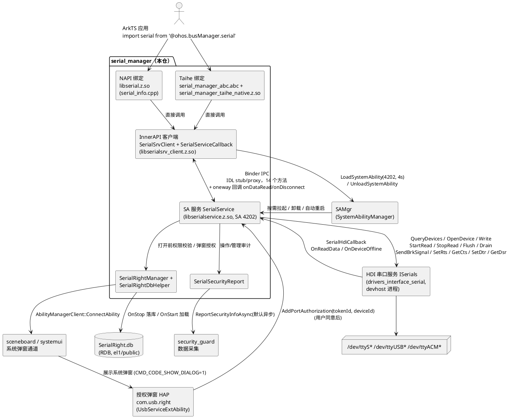

# 业务背景

## 应用定位

### 核心职责

serial_manager（部件 `@ohos/serial_manager`，部件名 `serial_manager`，子系统 `busmanager`，syscap `SystemCapability.BusManager.Serial`）是 OpenHarmony 的串口设备管理服务组件，以 System Ability 形态运行：**SA 4202**，进程 `serial_service`（uid/gid `serial`），按需加载、异常自动重启。服务注册见 `services/native/src/serial_service.cpp:90` 的 `REGISTER_SYSTEM_ABILITY_BY_ID(SerialService, SERIAL_SYSTEM_ABILITY_ID, true)` 与 `sa_profile/4202.json`。

面向串口外设的应用访问场景，本组件承担：

- **设备发现**：`getSerialPortList()` 经 HDI `ISerials::QueryDevices` 枚举板载串口（`ttyS`）、USB 转串口（`ttyUSB`）、USB CDC-ACM（`ttyACM`），返回 `SerialPort` 对象数组。
- **端口操作**：`open(config)` / `close()`，打开时配置波特率（默认 115200）、数据位（5-8，默认 8）、停止位（1/2，默认 1）、校验（none/even/odd/mark/space，默认 none）、硬件流控 RTS/CTS 与软件流控 XON/XOFF/XANY（默认全关）。
- **数据读写**：`write(data, timeout)` 异步写入（数据长度 (0, 4096]，timeout ∈ [0, 300000] ms，默认 0 非阻塞）；接收侧不提供同步 read，统一通过 `onDataRead` 回调由服务端推送。
- **串口信号**：`setRts` / `getCts` / `setDtr` / `getDsr` 读写流控与调制解调器信号。
- **缓冲控制**：`flush`（清空缓冲）、`drain`（等待发送完成）、`sendBrk`（发送断帧信号）。
- **应用级授权**：非系统应用首次 `open` 触发授权弹窗（连接 `com.usb.right` 弹窗 HAP），授权以"应用 × 设备"为粒度记录到内存缓存并在 SA 停止时落 RDB；系统应用经 `addPortAuthorization(tokenId, deviceId)` 代目标应用授权（`@systemapi`）。
- **企业管控**：监听 EDM 参数 `persist.edm.rs232_serial_disable`，置 1 时禁用 RS-232（板载串口）类端口，仅保留 USB 串口。
- **安全审计**：向 security_guard 上报串口操作事件（`0x030000100`）与串口管理事件（`0x030000101`）。
- **DFX**：hilog（域 `0xD002A08`，四个模块 tag）、`hidumper -s 4202` 设备信息 dump、hicollie IPC full 监控。

对外发布同一套 ArkTS API `@ohos.busManager.serial`（`@since 26.0.0 dynamic&static`），提供两条等价绑定路径：**NAPI 路径**（`interfaces/kits/js/napi/` → `libserial.z.so`）与 **Taihe 路径**（`interfaces/kits/js/taihe/` → `serial_manager_abc.abc` + `serial_manager_taihe_native.z.so`）。两条路径最终都委托 `SerialSrvClient`（inner_kit `serialsrv_client`，头文件 `interfaces/innerkits/native/include/serial_srv_client.h`）经 Binder IPC 访问 SA 4202。

### 职责边界（本组件不负责）

- **不实现串口驱动与设备节点管理**：真实 I/O 由 HDI 串口驱动服务（`drivers_interface_serial`，devhost 进程）与内核 tty 驱动承担。本服务只通过 `ISerials`/`ISerialDevice` 代理调用；HDI 代理不可用时服务退化为空枚举（`serial_service.cpp` `InitHdiProxy` 仅记录错误）。
- **不负责授权弹窗 UI 本体**：弹窗内容与用户交互属于 `com.usb.right` 应用（`UsbServiceExtAbility`），本服务经 AbilityManager 连接 sceneboard 系统弹窗通道（`com.ohos.sceneboard.systemdialog`，失败回退 `com.ohos.systemui.dialog`）请求展示，见 `services/native/src/serial_right_manager.cpp:287` `ConnectAbility`。
- **不负责 USB 基础设备管理**：USB 设备枚举、热插拔、USB 权限属于 usb_manager 仓；USB 转串口的基础同步/异步 read/write 能力仍由 usb_manager 的 serial 模块提供，与本仓能力互补、并行演进（详见 README「与 usb_manager 的关系与兼容性」）。
- **不负责权限库目录与设备节点初始化**：`services/serial_service.cfg` 的 `post-fs-data` job 由 init 执行（创建 `/data/service/el1/public/database/serial_manager` 目录、清理旧库文件、调整 tty 驱动属主与 `/dev/ttyHW8` 权限），不属于服务代码职责。
- **不负责 EDM 参数写入**：`persist.edm.rs232_serial_disable` 由企业设备管理（EDM）侧设置，本服务只监听（`WatchParameter`）并执行策略，同时该参数变更也是 SA 的 start-on-demand 触发源之一。
- **不提供同步 read 接口**：读取只有 `onDataRead`/`offDataRead` 回调模式（`ISerialServiceCallback.onDataRead` 为 `[oneway]` 异步推送）。

## 系统上下文

外部依赖部件（`bundle.json` deps）：hilog、init、napi、ipc、safwk、c_utils、samgr、security_guard、drivers_interface_serial、ability_runtime、ability_base、bundle_framework、common_event_service、os_account、relational_store、access_token、cJSON、config_policy、hicollie、hdf_core、runtime_core。

## 核心输入

| 输入 | 来源 | 主要内容 / 参数 | 触发时机 |
|---|---|---|---|
| IPC 方法调用（14 个） | 客户端 proxy（`SerialSrvClient` → `serial_server_proxy`） | `QuerySerialDevices`、`OpenSerial(portInfo, config, callback)`、`CloseSerial(portName)`、`WriteSerial(portName, buffer, timeout)`、`StartRead`/`StopRead`、`Flush`/`Drain`/`SendBrkSignal`、`SetRtsSignal`/`GetCtsSignal`/`SetDtrSignal`/`GetDsrSignal`、`AddPortAuthorization(tokenId, deviceId)` | 应用调用对应 JS API |
| 系统参数事件 | init 参数系统（EDM 写入） | `persist.edm.rs232_serial_disable` 取值 "0"/"1" | `WatchParameter` 回调（`serial_service.cpp:200`）；参数变更同时是 SA 的 start-on-demand 来源（`sa_profile/4202.json`） |
| CCM 配置文件 | `etc/serial/pcie_serial_config.json`（`GetOneCfgFile` 解析） | `pcieSerialPorts[].prefix` 与 `portIdOffset`，用于审计 portId 编码 | SA `OnStart`（`LoadPcieSerialConfig`） |
| HDI 数据回调 | `SerialHdiCallback::OnReadData` | `data`（int8 向量）、`dataLen` | HDI 异步读线程收到数据（须先 `StartRead`） |
| HDI 离线回调 | `SerialHdiCallback::OnDeviceOffline` | 无参，按回调对象绑定的 portName | 设备物理拔出或驱动离线 |
| 客户端死亡通知 | `SerialClientDeathRecipient::OnRemoteDied` | 死亡的回调远端对象 | 打开端口的客户端进程退出 |
| 授权数据库记录 | `SerialRight.db` 的 `serial_right` 表 | uid、device_id、bundle_name、token_id、时间戳、valid_period | SA `OnStart` 加载缓存（`SerialRightManager::Init`） |
| hidumper 请求 | `SerialService::Dump(fd, args)` | `-h`/`-a`/`-l` | `hidumper -s 4202` |

## 核心输出

| 输出 | 接收方 | 业务作用 |
|---|---|---|
| 设备列表 `SerialPortInfo[]`（`portName` 已剥离 `/dev/` 前缀） | 应用（`getSerialPortList` Promise） | 设备发现与后续打开的目标选择；同时驱动 NAPI/Taihe 层端口对象缓存的复用/失效判定 |
| 写入字节数 `bytesWritten` | 应用（`write` Promise） | 反映实际写入量（timeout=0 非阻塞时可能为 0） |
| 数据回调 `onDataRead(portName, buffer)` | 客户端 `SerialServiceCallback` → NAPI tsfn / Taihe async work → JS 回调 | 串口接收数据的唯一送达通道 |
| 断连回调 `onDisconnect(portName)` | 同上（经 `HandleDeviceOffline`） | 通知应用端口失效；NAPI 层据此把端口对象标记 invalidated |
| 授权记录 | 内存缓存 `rightCache_`（SA 生命周期内）→ `SerialRight.db`（`OnStop` 落库） | 决定后续 `open` 是否免弹窗；落库覆盖 SA 在同一次开机内的重启 |
| 审计事件 | security_guard（`ReportSecurityInfoAsync`） | 串口操作（Open/Close/Read/Write）与 RS-232 启停管理留痕 |
| hilog 日志 | DFX | 域 `0xD002A08`，tag：`SerialSrvClient`/`SerialService`/`SerialNapi`/`SerialTaihe` |
| dump 文本 | hidumper | 物理设备列表 + 已打开端口上下文（`DoDump`） |
| SA 卸载请求 | SAMgr `UnloadSystemAbility(4202)` | 无打开端口持续 30 秒后自卸载，释放系统资源 |
