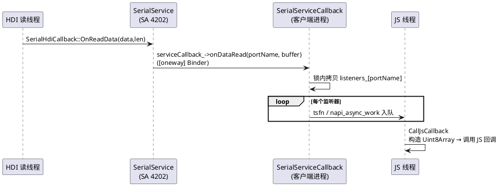
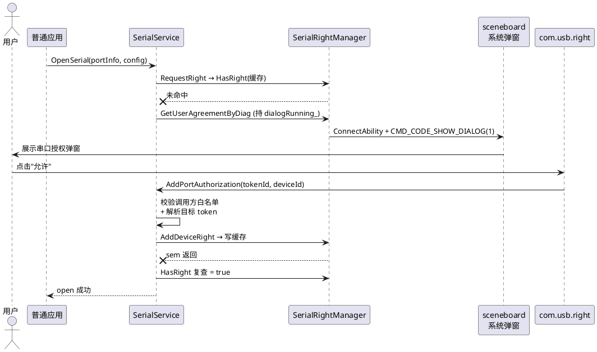

# 技术术语知识

serial_manager 模块核心技术框架和机制的知识定义，涵盖价值认知、原理、使用方式和代码关联。路径均相对仓根；行号以当前版本为准。

## IDL IPC 服务通信机制

### 解决的问题（Problem）

| 子维度 | 内容 |
|---|---|
| 业务痛点 | 应用进程（NAPI/Taihe 绑定层）与串口服务分属不同进程，需要类型安全、可演进的跨进程调用契约；服务端还需要主动向客户端推送数据与断连事件 |
| 技术目标 | 用 IDL 声明统一接口与数据结构，工具链自动生成 proxy/stub/序列化代码，消除手写 Binder 协议的错误面；以 oneway callback 支持服务端推送 |

### 原理（Principles）

| 子维度 | 内容 |
|---|---|
| 核心机制 | 三个 IDL 文件构成契约：`ISerialServer.idl`（14 个方法）、`ISerialServiceCallback.idl`（`[callback]` 接口，`onDataRead`/`onDisconnect` 均为 `[oneway]`）、`SerialServerTypes.idl`（`SerialPortInfo`/`SerialConfig` 结构）。编译期 IDL 工具链生成到 `out/<product>/gen/base/busmanager/serial_manager/interfaces/innerkits/`：proxy（客户端序列化+发送）、stub（服务端反序列化+虚函数分发）、types（结构序列化）、callback 的 proxy/stub（方向与主接口相反：callback_proxy 编入服务库、callback_stub 编入客户端库）。构建拆分见 `interfaces/innerkits/BUILD.gn`：`serialsrv_client` 目标取 `*_proxy.cpp`/`*_types.cpp`/`*callback_stub.cpp`，`serial_server_stub` 目标取 `*_stub.cpp`/`*callback_proxy.cpp` |
| 关键流程 | 请求：JS 方法 → `SerialSrvClient` 校验 → `proxy->Xxx()` 序列化发 Binder → SA 进程 `SerialService::OnRemoteRequest` → `SerialServerStub::OnRemoteRequest` 按码分发到 override 虚函数 → 返回码写回 reply → 客户端 `SerialInternalToJsCode` 转换。推送：服务持客户端传入的 callback proxy，`onDataRead(portName, data)` 单向异步投递 |

### 使用方式（Usage）

| 子维度 | 内容 |
|---|---|
| 核心 API | 应用侧无直接 IPC API；innerkit 使用者仅面对 `SerialSrvClient`（`interfaces/innerkits/native/include/serial_srv_client.h`）。服务端实现者 override `serial_service.h:109-124` 的 14 个方法；`OpenSerial` 的第三参数即回调 token，服务端将其存入 `DeviceContext::serviceCallback` |
| 调用前提 | 修改 `.idl` 后：`--fast-rebuild` 重新生成 → 核对生成物虚函数签名 → 同步 `serial_service.h/cpp` 与 `serial_srv_client.h/cpp`（AGENTS.md「IDL 代码生成」）。新增方法同样三处同步 |

### 代码关联（Code）

| 子维度 | 内容 |
|---|---|
| 核心类 | 契约：`interfaces/innerkits/*.idl`；分发入口：`SerialService::OnRemoteRequest`（`serial_service.cpp:1506`，直接委托 `SerialServerStub::OnRemoteRequest`） |
| 核心成员 | IDL 生成配置 `log_domainid = "0xD002A08"`（`interfaces/innerkits/BUILD.gn:21`） |
| 核心方法 | 14 个 IDL 方法的客户端封装（`serial_srv_client.cpp:126-398`）与服务端实现（`serial_service.cpp:429-1372`） |

### 约束与限制（Constraints）

| 子维度 | 内容 |
|---|---|
| 系统限制 | 生成物禁止手改（会被覆盖且破坏 wire 一致性）；已有方法签名与 IPC 码值变更属公开 API 兼容性事项，需请示 |
| 并发约束 | stub 方法在 SA IPC 线程池执行，服务端以 `serviceMutex_` 串行化状态访问；oneway 回调无回执，不能用于需要确认的语义 |
| 安全约束 | 回调通道随 `OpenSerial` 建立，服务端据此对象挂死亡通知；`AddPortAuthorization` 走调用方白名单（见授权机制） |

## SA 按需生命周期机制

### 解决的问题（Problem）

| 子维度 | 内容 |
|---|---|
| 业务痛点 | 串口管理属低频功能，常驻进程浪费内存；但 EDM 策略下发、应用首次调用都要求服务可被及时唤起；进程异常退出需自愈 |
| 技术目标 | 无人使用时尽快退出，有人使用时秒级可用，崩溃后自动恢复，且退出前完成授权数据落库 |

### 原理（Principles）

| 子维度 | 内容 |
|---|---|
| 核心机制 | 三层配合：①**注册**：`REGISTER_SYSTEM_ABILITY_BY_ID(SerialService, 4202, true)`（`serial_service.cpp:90`）+ `sa_profile/4202.json`（`run-on-create=false`，`auto-restart=true`，`start-on-demand` 监听 `persist.edm.rs232_serial_disable` 置 0/1）+ `services/serial_service.cfg`（init 侧 `ondemand=true`）。②**拉起**：客户端 `LoadSystemAbility(4202, 4s)` 或参数变更触发。③**卸载**：`Utils::Timer unloadTimer_`，`UNLOAD_SA_DELAY_MS=30000`；`DoUnloadSa()`（`serial_service.cpp:1556`）二次确认无打开端口且 SA 仍在加载态后 `UnloadSystemAbility`。`OnStart`（`serial_service.cpp:185`）序列：EDM 参数监听 → `InitHdiProxy` → `LoadPcieSerialConfig` → `SerialRightManager::Init`（加载授权缓存）→ IPC full 监控 → 定时器 Setup → `Publish` → `ScheduleUnloadSa`。`OnStop`（`serial_service.cpp:255`）序列：`SerialRightManager::OnStop`（落库）→ 取消定时器 → 持锁清理各 `DeviceContext`（摘死亡通知、**跳过 HDI Close**）→ 清表复位 |
| 关键流程 | 卸载触发点共四处：`OnStart` 末尾（发布即空闲）、`CloseSerial`/`OnClientDied`/`HandleDeviceOffline` 后 `deviceContexts_` 为空时；每次都先取消旧定时器再注册，`OpenSerial` 入口处取消（`serial_service.cpp:613-620`） |

### 使用方式（Usage）

| 子维度 | 内容 |
|---|---|
| 核心 API | 无对外 API。诊断：`hidumper -s 4202 [-a]`；SA 状态可经 `CheckSystemAbility` 探测 |

### 代码关联（Code）

| 子维度 | 内容 |
|---|---|
| 核心类 | `SerialService`（`services/native/include/serial_service.h:97`） |
| 核心成员 | `unloadTimer_`/`unloadTimerId_`/`UNLOAD_SA_DELAY_MS`、`registerToService_`、`g_serviceInstance` |
| 核心方法 | `OnStart`/`OnStop`/`OnIdle`/`ScheduleUnloadSa`/`CancelUnloadSa`/`DoUnloadSa`（`serial_service.cpp`） |

### 约束与限制（Constraints）

| 子维度 | 内容 |
|---|---|
| 系统限制 | 修改 `run-on-create`/`auto-restart`/`start-on-demand` 或 uid/secon 需请示（AGENTS.md「Ask before」）；`min_hdi_proxy_version`（`libserials_proxy_1.0.z.so`）约束 HDI 代理版本兼容 |
| 并发约束 | `DoUnloadSa` 在定时器线程执行，经 `GetDeviceCount()`（持锁）复核；30s 窗口内的新 `OpenSerial` 会取消定时器，无竞态泄漏 |
| 安全约束 | 落库必须先于任何清理（`OnStop` 第一步），否则授权丢失；关机路径不调 HDI Close（段错误风险） |

## HDI 串口设备对接机制

### 解决的问题（Problem）

| 子维度 | 内容 |
|---|---|
| 业务痛点 | 服务进程不能直接可靠操作 `/dev/tty*`（权限、多板卡差异、热插拔）；HDI 返回码体系与服务/JS 错误码体系不一致 |
| 技术目标 | 通过 HDI 代理把设备枚举与 I/O 委托给驱动服务进程，同时建立三层错误码映射与板级配置注入 |

### 原理（Principles）

| 子维度 | 内容 |
|---|---|
| 核心机制 | `InitHdiProxy`（`serial_service.cpp:316`）经 `ISerials::Get(true)` 取代理（持 `serviceMutex_`）。枚举：`QueryDevices` 返回 `SerialDeviceInfo` 数组，`ConvertDeviceInfo` 剥 `/dev/` 前缀并刷新 VID+PID 反查表。打开：`OpenDevice("/dev/"+portName, hdiConfig, hdiCallback, hdiDevice)`，`ConvertConfig` 完成 8 字段服务结构→HDI 结构的逐字段拷贝。操作：`Write(data, timeout, bytesWritten)`、`StartRead`/`StopRead`、`Flush`/`Drain`/`SendBrkSignal`/`SetRtsSignal`/`GetCtsSignal`/`SetDtrSignal`/`GetDsrSignal`、`Close`。错误映射 `SerialHdiToInternalCode`（`serial_service.cpp:54`）：`HDF_ERR_IO`/`HDF_DEV_ERR_NO_DEVICE`→`SERIAL_ERR_DEVICE_DISCONNECTED`；`HDF_ERR_INVALID_PARAM`→`SERIAL_ERR_INVALID_PARAM`；`HDF_ERR_TIMEOUT`→`SERIAL_ERR_TIMEOUT`；`HDF_ERR_DEVICE_BUSY`→`SERIAL_ERR_DEVICE_BUSY`；`HDF_ERR_BAD_FD`→`SERIAL_ERR_DEVICE_NOT_OPENED`；`HDF_ERR_NOPERM`→`SERIAL_ERR_PERMISSION_DENIED`；其余→`SERIAL_ERR_SERVICE`。板级配置：`LoadPcieSerialConfig`（`serial_service.cpp:331`）经 CCM `GetOneCfgFile` 读 `etc/serial/pcie_serial_config.json` 的 `pcieSerialPorts[].prefix/portIdOffset`，与固定项 `ttyS→2000` 合成 `pcieSerialOffsets_`，仅用于审计 portId 编码 |
| 关键流程 | 打开（见 Entity DeviceContext）；数据与离线回调经 `SerialHdiCallback` 桥接（读回调做 int8→uint8 转换后转发；离线回调经全局实例回服务） |

### 使用方式（Usage）

| 子维度 | 内容 |
|---|---|
| 核心 API | 服务内部机制，无对外 API。适配新板卡 = 提供 HDI 实现或扩展 `pcie_serial_config.json`（CCM 配置无需改码） |

### 代码关联（Code）

| 子维度 | 内容 |
|---|---|
| 核心类 | `SerialHdiCallback`（`serial_service.h:59`）；依赖 `drivers_interface_serial:libserials_proxy_1.0` |
| 核心成员 | `serialsProxy_`、`pcieSerialOffsets_`、偏移常量 `ACM_PORT_ID_OFFSET=1000`/`TTYS_PORT_ID_OFFSET=2000` |
| 核心方法 | `InitHdiProxy`、`ConvertConfig`、`ConvertDeviceInfo`、`OpenHdiDevice`、`CalculatePortId`、`SerialHdiToInternalCode` |

### 约束与限制（Constraints）

| 子维度 | 内容 |
|---|---|
| 系统限制 | HDI 代理获取失败不致命：服务仍启动（stub 模式仅记录错误，枚举返回 `SERIAL_ERR_SERVICE`）；HDI 读线程必须在 `StartRead` 后才会回调 |
| 并发约束 | 所有 HDI 调用发生在 `serviceMutex_` 临界区内；离线路径刻意不调 `Close()`（可能阻塞占锁，`serial_service.cpp:823`） |
| 安全约束 | 服务进程 SELinux 域 `u:r:serial_service:s0` 需有 HDI 访问权限；init cfg 中 `chown serial serial /proc/devhost/root/tty/driver`、`chmod 666 /dev/ttyHW8` 为板级配套 |

## 异步数据推送链与监听器多路复用

### 解决的问题（Problem）

| 子维度 | 内容 |
|---|---|
| 业务痛点 | 串口数据到达时机由对端决定，轮询式同步 read 会阻塞应用并占用 IPC；同一端口可能被应用内多处逻辑订阅 |
| 技术目标 | 服务端事件驱动推送、客户端按需启停底层读取、每端口多回调共享一条推送链、回调安全跨线程到达 JS 线程 |

### 原理（Principles）

| 子维度 | 内容 |
|---|---|
| 核心机制 | 四级链路：HDI 读线程 `OnReadData(data, len)` → `SerialHdiCallback::OnReadData`（int8→uint8 拷贝，`serial_service.cpp:133`）→ `serviceCallback_->onDataRead(portName, data)`（oneway Binder，无回执不阻塞）→ 客户端 `SerialServiceCallback::onDataRead`（锁内按 portName 拷贝回调列表，锁外逐个 `std::function`）→ 绑定层线程跃迁：NAPI 每个 JS 回调有独立 `napi_threadsafe_function`（`CreateThreadSafeFunction`，含 pendingQueue 缓冲），`CallJsCallback` 在 JS 线程构造 `Uint8Array` 后调用；Taihe 经 `napi_async_work`（`ScheduleCallbackAsyncWork`）在 Complete 回调（JS 线程）内以 `taihe::array<uint8_t>` 逐个调用。启停控制：`RegisterDataListener` 在 `listenerMutex_` 内判断"首个监听器"→ IPC `StartRead`（失败回滚）；`UnregisterDataListener` 判断"最后一个移除"→ IPC `StopRead`。断连推送：服务端 `HandleDeviceOffline` → `onDisconnect(portName)` → 客户端分发断连回调后自动 `RemoveAllListeners`（数据监听器一并清理） |
| 关键流程 | 入口 `StartRead`（首个监听器注册触发）→ HDI 异步读线程产出数据 → 四级链路推送到 JS 回调；`StopRead`（最后一个监听器移除触发）后链路静默。时序见下图 |

### 使用方式（Usage）

| 子维度 | 内容 |
|---|---|
| 核心 API | JS：`port.onDataRead((data: Uint8Array) => {})` / `port.offDataRead([callback])`（不传清全部）、`port.onDisconnect(cb)` / `offDisconnect([cb])`；innerkit：`RegisterDataListener(portName, callback, &handle)` / `UnregisterDataListener(portName, handle)`、`RegisterDisconnectedListener`/`UnregisterDisconnectedListener`。调用前提：端口已 `open`（NAPI 层 `CheckPortOpened` 校验，未打开抛 35700005）；同名 JS 函数重复注册被跳过 |

### 代码关联（Code）

| 子维度 | 内容 |
|---|---|
| 核心类 | `SerialServiceCallback`、NAPI `CallbackInfo/CallbackData`、Taihe `CallbackEntry/CallbackWorkData` |
| 核心成员 | `listeners_`/`nextListenerHandle_`（innerkit）、`g_dataCallbacks`/`g_disconnectedCallbacks`（NAPI）、`g_callbacks`/`g_innerkitHandles`（Taihe，每端口单 innerkit 句柄多路广播） |
| 核心方法 | `SerialServiceCallback::onDataRead/onDisconnect`（`serial_service_callback.cpp:22/123`）、`SerialSrvClient::RegisterDataListener/UnregisterDataListener`（`serial_srv_client.cpp:400-491`）、NAPI `RegisterOnDataReadListener`/`CallJsCallback`（`serial_info.cpp:1155-1275`）、Taihe `InvokeCallbacks`/`ScheduleCallbackAsyncWork`（`ohos.busManager.serial.impl.cpp:338-407`） |

### 约束与限制（Constraints）

| 子维度 | 内容 |
|---|---|
| 系统限制 | oneway 回调依赖 Binder 缓冲，洪泛时有丢弃风险（已挂 `IpcFull` 30s 监控）；数据不经服务端缓存，HDI 回调到达时若无监听器即丢弃（仅记日志） |
| 并发约束 | 注册/注销与启停判定必须原子（`listenerMutex_` 整体覆盖）；回调执行在锁外，注销后已在途的回调仍可能再触发一次（tsfn abort 尽力收敛） |
| 安全约束 | 回调通道仅服务端使用，应用无法伪造（callback 对象由 stub 持有）；断连回调后 NAPI 端口对象自动标记失效，后续操作返回 35700003 |

## 端口对象缓存与失效恢复机制

### 解决的问题（Problem）

| 子维度 | 内容 |
|---|---|
| 业务痛点 | `getSerialPortList()` 每次返回新对象会让应用持有的旧端口对象与监听器失效；设备热插拔后同端口复现需要恢复身份；JS 对象泄漏会连带泄漏原生资源 |
| 技术目标 | 同一物理端口跨查询返回同一 JS 对象；设备消失/信息变化时旧对象安全失效；GC 时自动兜底关闭 |

### 原理（Principles）

| 子维度 | 内容 |
|---|---|
| 核心机制 | NAPI 层双表（`serial_info.cpp:179-181`）：`g_activePorts`（portName→`SerialPortNative*`，对象持强引用 ref=1 阻止 GC）与 `g_invalidatedPorts`（弱引用池）。每次列表 Complete 时 `CreateDeviceListArray` 执行四步：①`TryReuseActivePort`：活动表中存在且 `IsSerialPortInfoEqual` → 复用原 JS 对象（若曾被标记 invalidated 则清除，记 RESTORE(reconnect)）；信息不等 → `InvalidatePort` 后走新建。②`RestoreInvalidatedPort`：失效池中信息相等且 `napi_get_reference_value` 仍可取回 → 弱引用升强、invalidated 复位、回活动表（RESTORE）；引用已空（对象已被 GC）→ 删除原生结构。③`CreateNewPortObject`：new `SerialPortNative` → `napi_wrap` 绑定 finalize → 建强引用入活动表。④`InvalidateDisappearedPorts`：本次列表未出现的活动端口全部 `InvalidatePort`。`InvalidatePort`（`serial_info.cpp:434`）：置 invalidated、清监听器、强引用降弱引用、入失效池。`SerialPortFinalize`（GC 终结器，`serial_info.cpp:233`）：**已打开且未失效**的对象自动 `CloseSerial` + 清监听器（防泄漏兜底），再清两表与引用。设备断连路径：`open` 成功时注册的断连监听把对象标记 `invalidated+!isOpened`（`serial_info.cpp:674-686`），不直接删除。Taihe 层以 `g_cachedPorts`（`CachedPortInfo`：holder + 身份字段）+ `g_holderRegistry`（multimap portName→holder*）实现同构机制，断连经 `InvalidateAllHoldersForPort` 失效 |
| 关键流程 | 状态机：CREATE →（活动，强引用）→ INVALIDATE（消失/信息变/断连，弱引用）→ RESTORE（复现且信息同，回强引用）或 GC（finalize 清理）；REUSE 为活动态内的直接命中 |

### 使用方式（Usage）

| 子维度 | 内容 |
|---|---|
| 核心 API | 应用无感知；对失效对象调用任意方法被 `IsPortInvalidated` 拦截并返回 35700003。测试需触发 GC 时：活动对象因强引用**不会**被回收，必须等待端口从列表消失（INVALIDATE）后制造内存压力（AGENTS.md「常见陷阱 5」） |

### 代码关联（Code）

| 子维度 | 内容 |
|---|---|
| 核心类 | `SerialPortNative`、Taihe `SerialPortHolder`/`CachedPortInfo` |
| 核心成员 | `g_activePorts`/`g_invalidatedPorts`（NAPI）、`g_cachedPorts`/`g_holderRegistry`（Taihe） |
| 核心方法 | `CreateDeviceListArray`、`TryReuseActivePort`、`RestoreInvalidatedPort`、`CreateNewPortObject`、`InvalidateDisappearedPorts`、`InvalidatePort`、`SerialPortFinalize`、`RemoveAllListenersForPort`（`serial_info.cpp:183-579`） |

### 约束与限制（Constraints）

| 子维度 | 内容 |
|---|---|
| 系统限制 | 全进程单 napi_env 假设（对象表不区分 env）；失效池靠 GC 收敛，长时间无 GC 时原生结构滞留（弱引用不阻止） |
| 并发约束 | 两表由 `g_portCacheMutex` 保护；`invalidated`/`isOpened` 为 atomic，跨线程标记安全 |
| 安全约束 | finalize 自动 close 保证"应用泄漏对象不泄漏端口"；该兜底只在"已打开未失效"时触发，显式 `close()` 之后的对象由正常路径清理 |

## 应用授权机制

### 解决的问题（Problem）

| 子维度 | 内容 |
|---|---|
| 业务痛点 | 串口可触达敏感外设（支付、工业控制），普通应用直接访问有越权风险；系统应用又需要免弹窗与代授权能力 |
| 技术目标 | "应用 × 设备 × 用户"粒度的用户可见授权：首次打开弹窗确认、授权结果可跨 SA 重启、系统弹窗 HAP 代为写回、系统应用旁路 |

### 原理（Principles）

| 子维度 | 内容 |
|---|---|
| 核心机制 | 入口在 `OpenSerial`（`serial_service.cpp:652` `RequestSerialPortRight`）：①系统 HAP 应用（`IsSystemAppOrSa` 为 true）直接放行。②否则 `HasRight` 查缓存（键 `userId_deviceId_bundleName_tokenId`，空 bundleName 记 `serial_cli`），命中放行。③未命中进入弹窗：`GetUserAgreementByDiag` 持 `dialogRunning_`（全局单弹窗）→ `ShowSerialDialog`：`GetAppName`（BundleResource 取 label，失败用 bundleName）填充静态 `dialogParams_`（appName/portName/tokenId/deviceId/uiExtensionType=`sysDialog/common`；tokenId 先 `stoul` 再截为 int32 字符串化）→ `sem_init` → `ConnectAbility`：先连 `com.ohos.sceneboard.systemdialog`，失败回退 `com.ohos.systemui.dialog` → `OnAbilityConnectDone` 以 MessageParcel（bundleName=`com.usb.right`、abilityName=`UsbServiceExtAbility`、cJSON 参数串）发 `CMD_CODE_SHOW_DIALOG=1` → `sem_wait` 阻塞 IPC 线程等用户操作 → 弹窗关闭触发 `OnAbilityDisconnectDone` `sem_post`。用户同意后弹窗 HAP 反向调用 `AddPortAuthorization(tokenId, deviceId)`：服务端 `ValidateDialogHapCaller` 校验调用方（HAP token + 系统应用 + bundleName==`com.usb.right`）→ `ParseTargetTokenId`（strtoull 十进制全匹配）→ 取目标 `HapTokenInfo` → `AddDeviceRight` 写缓存（validPeriod 永久）→ 弹窗侧 `sem` 返回后服务端以 `HasRight` 复查（同意=true，拒绝或 HAP 失败=false → `SERIAL_ERR_PERMISSION_DENIED` 35700007）。持久化：SA `OnStart` `LoadCacheFromDb`（库不存在则空缓存）；SA `OnStop` `SaveCacheToDb`（建库 + `InsertAllRecords` 批量插入后清缓存）。注意 init `post-fs-data` 每次开机删除库文件，授权实际有效期为"单次开机内" |
| 关键流程 | 未授权应用 `open` → 弹窗授权 → 弹窗 HAP 回写授权 → 复查放行；拒绝/失败返回 35700007。时序见下图 |

### 使用方式（Usage）

| 子维度 | 内容 |
|---|---|
| 核心 API | 应用侧：`serial.addPortAuthorization(tokenId: string, deviceId: string): Promise<void>`（`@systemapi`，仅授权弹窗系统应用可用）；普通应用无授权 API，授权由 `open` 间接触发。资源收尾：授权无取消接口，缓存随 SA 生命周期与开机周期重置 |

### 代码关联（Code）

| 子维度 | 内容 |
|---|---|
| 核心类 | `SerialRightManager`（含内部类 `SerialAbilityConn`）、`SerialRightDbHelper`（`services/native/`） |
| 核心成员 | `rightCache_`/`cacheMutex_`/`dialogRunning_`、静态 `waitDialogDisappear_`/`dialogParams_`/`dialogParamsMutex_`、`SerialDeviceInfoForDialog`（`serial_right_manager.h:54`） |
| 核心方法 | `RequestRight`/`GetUserAgreementByDiag`/`ShowSerialDialog`/`ConnectAbility`/`AddDeviceRight`/`HasRight`/`LoadCacheFromDb`/`SaveCacheToDb`（`serial_right_manager.cpp`）；`AddPortAuthorization`/`ValidateDialogHapCaller`/`ParseTargetTokenId`/`BuildDeviceId`（`serial_service.cpp:1277-1372, 1590`） |

### 约束与限制（Constraints）

| 子维度 | 内容 |
|---|---|
| 系统限制 | 弹窗依赖 sceneboard/systemui 与 `com.usb.right` 在位；`sem_wait` 无超时，弹窗通道异常会长时间占住 IPC 线程（有 `dialogRunning_` 串行化兜底不扩散）；deviceId 含 portName，设备换口需重新授权 |
| 并发约束 | 全局同时只允许一个弹窗；缓存读写持 `cacheMutex_`；授权写入（弹窗回调线程）与读取（open IPC 线程）经锁互斥 |
| 安全约束 | 调用方白名单（`com.usb.right`）与目标 token 解析校验不可放宽；缓存键与表结构变更需请示（数据迁移）；RDB 置于 el1/public + S1，属公共目录敏感数据 |

## 企业策略管控机制（EDM）

### 解决的问题（Problem）

| 子维度 | 内容 |
|---|---|
| 业务痛点 | 企业场景需要一键禁用板载 RS-232（防外设接入调试口），但不影响 USB 串口等业务外设 |
| 技术目标 | 策略下发即时生效（服务未运行也能被拉起），对所有串口操作一致拦截，且留管理审计 |

### 原理（Principles）

| 子维度 | 内容 |
|---|---|
| 核心机制 | 参数 `persist.edm.rs232_serial_disable`（常量 `RS232_MDM_PARAM`，`serial_service.cpp:85`）三重角色：①init `start-on-demand`：置 0/1 都会拉起 SA（`sa_profile/4202.json`）。②动态监听：`OnStart` 注册 `WatchParameter`，回调中 `SetSerialManagePolicy(disable)`（原子写 `isRs232Disabled_`）+ 上报管理审计事件。③首次上报抑制：`reportManageFlag_` 仅在"参数此前未设置"或"SA 因该参数启动"时为 true；false 时首次管理事件被吞掉（避免非参数触发的启动对旧值重复上报，`serial_service.cpp:195-198, 1741-1747`）。执行面：`QuerySerialDevices` 过滤非 `IsUsbSerial` 设备，若原本有设备但全被过滤返回 `SERIAL_ERR_ENTERPRISE_POLICY`（JS 203，`serial_service.cpp:460`）；`OpenSerial` 及全部端口操作对非 USB 端口直接拒绝（当前返回 `SERIAL_ERR_SERVICE`，`serial_service.cpp:603` 等处——注意操作拒绝用的不是 203，枚举耗尽才用 203，以代码为准） |
| 关键流程 | EDM 写参数 → init 拉起（或已运行则回调）→ `isRs232Disabled_` 原子置位 → 枚举过滤 + 操作拒绝 → 管理审计事件（portType=RS232, portStatus=Enabled/Disabled） |

### 使用方式（Usage）

| 子维度 | 内容 |
|---|---|
| 核心 API | 无应用侧 API。设置方式为系统参数（EDM 侧）；`param get persist.edm.rs232_serial_disable` 可查看 |

### 代码关联（Code）

| 子维度 | 内容 |
|---|---|
| 核心类 | `SerialService` |
| 核心成员 | `isRs232Disabled_`（`std::atomic<bool>`）、`reportManageFlag_` |
| 核心方法 | `SetSerialManagePolicy`、`IsUsbSerial`、`ReportSerialManageAuditEvent`（`serial_service.cpp:1730-1757`） |

### 约束与限制（Constraints）

| 子维度 | 内容 |
|---|---|
| 系统限制 | 参数名固定不可改（init 配置与服务代码双向依赖）；策略只认 USB/ACM 字符串判定，新前缀需评估 |
| 并发约束 | `isRs232Disabled_` 原子读，操作路径无额外锁依赖；监听回调经 `g_serviceInstance` 全局指针路由（OnStart 已赋值） |
| 安全约束 | 策略属企业管控，服务端只执行不溯源；管理事件审计留痕 |

## 安全审计上报机制

### 解决的问题（Problem）

| 子维度 | 内容 |
|---|---|
| 业务痛点 | 串口操作涉及资金/工业外设，安全事故追责需要"谁在何时对哪个端口做了什么"的不可抵赖记录 |
| 技术目标 | 覆盖打开/关闭/首次读/首次写四类操作与策略启停，字段稳定可采集，上报不阻塞业务 |

### 原理（Principles）

| 子维度 | 内容 |
|---|---|
| 核心机制 | `SerialSecurityReport::ReportSecurityInfo(eventId, version, json, isAsync=true)`（`serial_security_report.cpp:36`）封装 security_guard `NativeDataCollectKit`；`SECURITY_GUARD_ENABLE` 编译门控（部件存在性决定，`services/BUILD.gn:89-93`），未启用时退化为 debug 日志。两事件：操作 `0x030000100`（`ReportSerialOperationAudit`，字段 happenTime/portId/operationType/uid）；管理 `0x030000101`（`ReportSerialManageAuditEvent`，字段 portType/portStatus/userId/happenTime）。上报节流：`portsHasBeenRead_`/`portsHasBeenWritten_` 集合使 read/write 每端口（本次打开周期内）只报首次，`CloseSerial` 时 `ResetFirstRead/Write` 重置；open/close 每次都报。portId 编码见术语表 |
| 关键流程 | `OpenSerial`/`CloseSerial`/`StartRead`/`WriteSerial` 入口处构造 JSON → 异步上报（不等待结果） |

### 使用方式（Usage）

| 子维度 | 内容 |
|---|---|
| 核心 API | 服务内部机制。无对外 API；不可跳过（AGENTS.md「Do not」） |

### 代码关联（Code）

| 子维度 | 内容 |
|---|---|
| 核心类 | `SerialSecurityReport` |
| 核心成员 | 事件 ID/版本常量（`serial_service.h:46-49`）、`portsHasBeenRead_`/`portsHasBeenWritten_` + 独立互斥锁 |
| 核心方法 | `ReportSerialOperationAudit`、`ReportSerialManageAuditEvent`、`QueryAndRecordFirstRead/Write`、`ResetFirstRead/Write`、`CalculatePortId`、`GetCurrentTime`（ms 时间戳） |

### 约束与限制（Constraints）

| 子维度 | 内容 |
|---|---|
| 系统限制 | 事件 ID、字段名、版本串是采集契约，禁止修改；异步上报不保证送达时序 |
| 并发约束 | 首/重置标记集合独立加锁，避免并发首调漏报或重报 |
| 安全约束 | 服务进程持 `securityguard.REPORT_SECURITY_INFO` 权限（`serial_service.cfg`）；uid 字段来自 `IPCSkeleton::GetCallingUid`，不可伪造 |

## 统一错误码体系

### 解决的问题（Problem）

| 子维度 | 内容 |
|---|---|
| 业务痛点 | 同一失败要在 HDI 码、内部码、JS 码三套体系间流转；NAPI/Taihe/innerkit 三层各自返回错误会造成语义漂移 |
| 技术目标 | 分段映射、单点收口：HDI→内部（服务端）、内部→JS（客户端）、JS→`BusinessError`（绑定层） |

### 原理（Principles）

| 子维度 | 内容 |
|---|---|
| 核心机制 | 内部码 `SERIAL_ERR_SERVICE=-1` … `SERIAL_ERR_PARAM_ERROR=-11`（`serial_error_code.h:26-36`）；JS 码 `35700001`…`35700008` + `202`（非系统应用）/`203`（企业策略）/`401`（参数错误）。`SerialInternalToJsCode()`（`serial_error_code.cpp:21`）一一映射、未知码落 `35700001`；`SerialJsErrorMessage()` 提供英文文案。流经路径：HDI 码 → `SerialHdiToInternalCode`（服务端）→ IPC 返回 → `SerialInternalToJsCode`（客户端，`serial_srv_client.cpp` 各方法）→ NAPI `CreateBusinessError`（`napi_create_error` + `napi_create_int32` 码）/ Taihe `taihe::set_business_error`（`CheckAndThrowOnError`）。客户端本地校验失败直接返回 JS 码（如空 portName → `SERIAL_JS_ERR_INVALID_PARAM`）。stub 形态（无 SA）`SERIAL_JS_ERR_NOT_SUPPORTED=801` |
| 关键流程 | `.d.ts` 每方法 `@throws` 声明对外错误码面；新增错误码须同步 `serial_error_code.h/cpp` 与 `.d.ts` |

### 使用方式（Usage）

| 子维度 | 内容 |
|---|---|
| 核心 API | innerkit 调用方拿到的是**JS 码**（客户端已完成转换），直接判 `SERIAL_OK(0)` 或 JS 码即可；JS 应用 catch `BusinessError` 取 `err.code` |

### 代码关联（Code）

| 子维度 | 内容 |
|---|---|
| 核心类 | 无类，纯函数与常量（`utils/native/`） |
| 核心成员 | 两套常量表 + `801` stub 码 |
| 核心方法 | `SerialInternalToJsCode`、`SerialJsErrorMessage`、`SerialHdiToInternalCode`（服务侧） |

### 约束与限制（Constraints）

| 子维度 | 内容 |
|---|---|
| 系统限制 | 数值与语义冻结，变更需请示；追加只能在尾部（避免位移既有值） |
| 并发约束 | 纯函数无状态 |
| 安全约束 | `202/203/401` 为系统级语义码，不可挪用为业务码 |

## 客户端连接与死亡重连机制

### 解决的问题（Problem）

| 子维度 | 内容 |
|---|---|
| 业务痛点 | SA 按需加载意味着首次调用时服务可能不存在；SA 空闲自卸载或崩溃后，客户端持有的代理失效；应用不感知这些细节 |
| 技术目标 | 懒加载 + 死亡感知 + 透明重连，绑定层无感 |

### 原理（Principles）

| 子维度 | 内容 |
|---|---|
| 核心机制 | `SerialSrvClient` 为 static 局部变量单例（`serial_srv_client.cpp:57`）。构造时创建 `SerialSrvDeathRecipient` 与共享的 `SerialServiceCallback`。`GetProxy()`（`serial_srv_client.cpp:82`）持 `mutex_`：代理空则 `ConnectUnLocked(force=true)` → `SystemAbilityManagerClient` 取 samgr → `LoadSystemAbility(4202, MAX_WAIT_LOAD_SA_SECONDS=4)` → 成功则挂死亡通知并 `iface_cast<ISerialServer>`。服务死亡 → `OnRemoteDied` → `ResetProxy`（核对死亡对象确为本代理后摘通知、置空）→ 下一次任意方法调用自动走 `GetProxy` 重连（服务侧由 samgr/auto-restart 负责重启）。参数预校验在连接前完成（portName 非空、配置范围、write 上限），失败不发起 IPC |
| 关键流程 | 首调（懒加载 4s）→ 成功缓存代理 → 服务卸载/崩溃 → 死亡通知置空 → 下次调用重连。监听器注册路径（`listenerMutex_`）内嵌 `GetProxy`，StartRead 失败会回滚已注册的表项 |

### 使用方式（Usage）

| 子维度 | 内容 |
|---|---|
| 核心 API | `SerialSrvClient::GetInstance()` 后直接调 14 个业务方法或 4 个监听器方法；连接失败返回 `SERIAL_JS_ERR_SERVICE`（35700001）。使用方无需（也无法）显式连接/断开 |

### 代码关联（Code）

| 子维度 | 内容 |
|---|---|
| 核心类 | `SerialSrvClient`、内部 `SerialSrvDeathRecipient` |
| 核心成员 | `proxy_`/`deathRecipient_`/`callback_`/`mutex_`/`listenerMutex_` |
| 核心方法 | `GetInstance`、`GetProxy`、`ConnectUnLocked`、`ResetProxy`（`serial_srv_client.cpp:57-124`） |

### 约束与限制（Constraints）

| 子维度 | 内容 |
|---|---|
| 系统限制 | 4s 加载超时是硬上限；重连是"下次调用时"而非主动侦测，两次调用之间的死亡不产生通知给上层 |
| 并发约束 | `mutex_` 保护代理指针；`ResetProxy` 与 `GetProxy` 竞争安全；死亡回调线程与业务线程互斥 |
| 安全约束 | 无额外权限要求（SAMgr 访问）；死亡通知避免悬挂代理调用已亡对象 |
